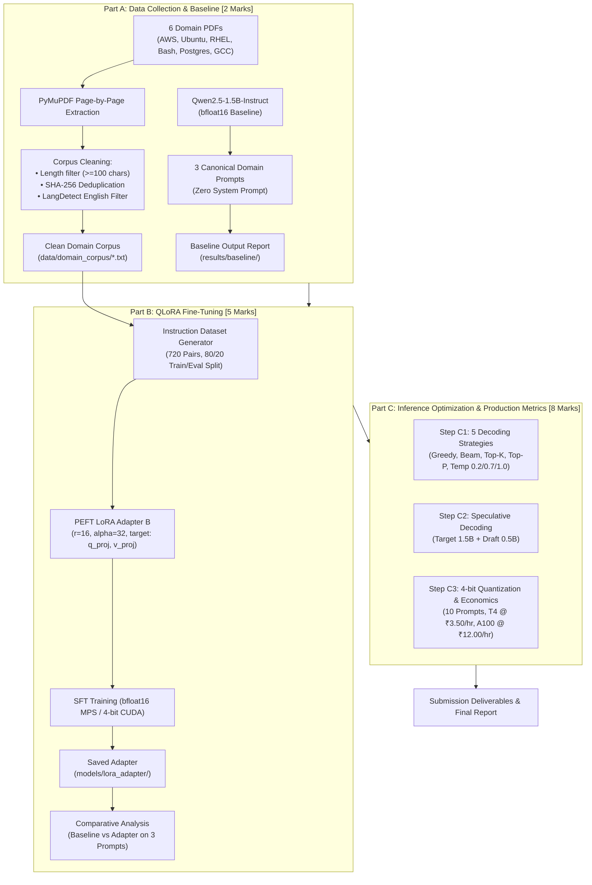

# System Architecture & Technical Flow

## 1. End-to-End Enterprise LLM Pipeline

## 2. Directory & Component Design

- **`configs/`**: Strict YAML separation of model parameters, training hyperparameters, and benchmark configurations.
- **`data/`**: Structured data flow: `raw_pdfs/` → `extracted_text/` → `domain_corpus/` → `train.jsonl` / `eval.jsonl`.
- **`src/`**: Modular Python modules adhering to PEP 8, type hinting, and robust exception handling.
- **`notebooks/`**: Educational, reproducible notebooks tracking each academic step with inline visualizations.
- **`results/`**: Structured JSON, CSV, and PNG outputs for reproducible grading.
- **`submission/`**: Consolidated HTML exports, executive reports, and rubric compliance tables.
